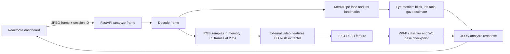

# Multimodal Smart Adaptive Learning System

Research software for exploring learner engagement signals and adaptive learning experiences. This repository brings the React/Vite dashboard, FastAPI eye-tracking service, live I3D feature extraction, and W0-P engagement classifier together with the project’s existing research code.

The live analysis path is intended for research and local evaluation. It estimates face presence, blink activity, and screen-directed gaze from a webcam stream, then classifies sampled video clips with a trained W0-P model. The dashboard displays the model output and confidence alongside the eye metrics. The application does not yet provide a complete learner account, persistent session store, or a live data-driven adaptive curriculum.

## Contents

- [Project overview](#project-overview)
- [Features and implementation status](#features-and-implementation-status)
- [Architecture](#architecture)
- [Repository structure](#repository-structure)
- [Requirements](#requirements)
- [Setup](#setup)
- [External model assets](#external-model-assets)
- [Run the application](#run-the-application)
- [API](#api)
- [Testing](#testing)
- [Troubleshooting](#troubleshooting)
- [Technology stack](#technology-stack)
- [Limitations](#limitations)
- [Privacy](#privacy)
- [Research data paths](#research-data-paths)

## Project overview

The project explores how multimodal observations could inform more responsive learning experiences. Its intended users are researchers and developers studying learner engagement and personalized learning workflows.

The current live path uses webcam frames to estimate eye-related measures and to classify short video windows. These measurements can provide experimental signals for later adaptation research. They should not be treated as a definitive measure of a learner’s attention, comprehension, or wellbeing.

## Features and implementation status

### Implemented in the application

- **Student dashboard:** React page at `/` with a live webcam panel and live model/eye metrics.
- **Learning page:** course cards and recommended learning items at `/learning`.
- **Analytics page:** engagement and study charts at `/analytics`.
- **Settings page:** notification, privacy, appearance, and language controls at `/settings`.
- **Webcam capture:** browser requests camera access and sends JPEG frames to the backend while the dashboard is open.
- **Face and eye landmarks:** MediaPipe Face Landmarker provides face landmarks and iris positions.
- **Blink detection and rate:** an eye-aspect-ratio threshold detects blink events. The dashboard shows the running count and reports a rate after a 60-second valid observation window.
- **Gaze and estimated eye contact:** iris positions relative to each eye opening are used for a heuristic screen-directed gaze estimate and a rolling estimate of time looking toward the screen.
- **I3D features:** the backend samples RGB frames at 2 frames per second, collects 65 samples, and extracts a 1024-dimensional I3D representation.
- **W0-P classification:** the extracted feature is passed to the configured trained W0-P checkpoint. The dashboard displays the returned engagement class and confidence.
- **Model collection status:** before the first prediction, the dashboard reports clip collection or feature extraction status.

### Presentational, local-only, or planned

- The learning course cards and progress values are sample UI; they are not loaded from a learner database.
- Analytics charts and session summary values are static examples, not computed from saved sessions or the live webcam stream.
- Adaptive feedback and the explanatory insight are static text. The buttons do not currently change lesson content or trigger an adaptive-learning service.
- Settings toggles are component-local state and are not persisted to an account or backend.
- Audio analysis and handwriting analysis appear as unavailable modules; their processing pipelines are not implemented in this application.

## Architecture



The API loads its I3D extractor when the service starts. It loads the W0-P classifier when inference is first needed. The frontend consumes `POST /analyze-frame`; `POST /predict-engagement` is also available for a caller that already has a 1024-value I3D feature.

## Repository structure

```text
.
├── README.md
├── docs/
│   └── live-engagement-setup.md
├── frontend/                         # React, TypeScript, Vite dashboard
│   ├── src/
│   │   ├── components/dashboard/     # Dashboard and webcam components
│   │   ├── components/ui/            # Reusable Radix/shadcn-style UI
│   │   └── pages/                    # Dashboard, learning, analytics, settings
│   ├── package.json
│   └── package-lock.json
├── Pupil-dilation/                   # FastAPI and computer-vision backend
│   ├── api.py
│   ├── eye_cropper.py
│   ├── live_i3d.py
│   ├── model_inference.py
│   ├── face_landmarker.task
│   └── requirements.txt
├── cmose-few-shot-personalisation/   # CMOSE experiments and reports
├── eye-stream-on-daisee/             # Eye-stream research
├── personalisation/                  # Personalization experiments
├── models/                            # Model experiments and notebooks
└── Fixation-Duration_Saccade-Velocity/ # Fixation/saccade research code
```

The frontend has its own [README](frontend/README.md). The application setup notes are in [docs/live-engagement-setup.md](docs/live-engagement-setup.md).

## Requirements

- Python 3.10 or newer.
- Node.js and npm (use a Node release supported by the Vite version in `frontend/package.json`).
- A webcam and browser permission for webcam access.
- The external I3D library and its RGB weights, and the exported W0-P/W0 checkpoint files. These are not stored in this repository.
- A compatible PyTorch/TorchVision installation. For GPU use, select matching builds for the target platform; CPU inference is configured by the current live I3D integration.

## Setup

Clone this repository and create a Python environment from the repository root:

```bash
git clone https://github.com/Niharika-Paul/Multimodal-Smart-Adaptive-Learning-System-for-Diverse-Learners.git
cd Multimodal-Smart-Adaptive-Learning-System-for-Diverse-Learners

python3 -m venv .venv
source .venv/bin/activate
python -m pip install --upgrade pip
python -m pip install -r Pupil-dilation/requirements.txt
```

The requirements include FastAPI/Uvicorn, OpenCV, MediaPipe, NumPy, PyTorch/TorchVision, OmegaConf, h5py, and SciPy. If installing PyTorch/TorchVision requires a platform-specific wheel, use the [official PyTorch installation selector](https://pytorch.org/get-started/locally/) and then install the remaining requirements.

Configure the external model assets as described below. Configure the frontend API origin by copying the example file:

```bash
cp frontend/.env.example frontend/.env.local
```

Edit `frontend/.env.local` if the backend will use a different address. Vite reads this variable when it starts.

## External model assets

The model library, pretrained I3D weights, and trained W0-P checkpoint export are intentionally excluded from GitHub. Obtain them from the project’s authorized research storage and keep their paths local.

The live I3D integration expects this structure under `I3D_LIBRARY_DIR`:

```text
video_features/
├── configs/i3d.yml
└── models/i3d/checkpoints/i3d_rgb.pt
```

`I3D_LIBRARY_DIR` is the root of the upstream [`video_features`](https://github.com/v-iashin/video_features) checkout. Install any additional dependencies required by that library as well as the project requirements.

The W0-P export root under `W0P_CHECKPOINT_DIR` must contain the selected W0-P checkpoint and its referenced W0 base checkpoint:

```text
CMOSE_WOP_checkpoints_export/
├── w0p_checkpoints/
│   └── fold_1__video14_person0__random__K20.pt
└── w0_base_checkpoints/
    └── w0_fold_1.pt
```

The selected W0-P checkpoint contains the relative reference to its base checkpoint. Keep the export’s directory layout intact. The API currently selects `fold_1__video14_person0__random__K20.pt`.

Set the paths and allowed frontend origins in the shell that starts the backend. Replace the example paths with locations on your machine:

```bash
export I3D_LIBRARY_DIR="/path/to/video_features"
export W0P_CHECKPOINT_DIR="/path/to/CMOSE_WOP_checkpoints_export"
export FRONTEND_ORIGINS="http://localhost:8080,http://127.0.0.1:8080"
```

The MediaPipe face landmark asset, `Pupil-dilation/face_landmarker.task`, is included in the repository. The I3D library, I3D weights, W0-P/W0 checkpoints, training notebook, and extracted training feature JSON are not included.

## Run the application

Start the backend in Terminal 1. Starting from the repository root, use:

```bash
cd Pupil-dilation
python -m uvicorn api:app --host 127.0.0.1 --port 8001
```

Run this in the same shell where `I3D_LIBRARY_DIR`, `W0P_CHECKPOINT_DIR`, and (if needed) `FRONTEND_ORIGINS` were set. Start from `Pupil-dilation/` because the MediaPipe asset is opened relative to the backend working directory.

Start the frontend in Terminal 2:

```bash
cd frontend
npm ci
npm run dev
```

Vite is configured for port `8080`. Open [http://localhost:8080](http://localhost:8080) and allow camera access. For production assets, build with `npm run build`; `npm run preview` serves the built frontend locally.

## API

### `GET /health`

Returns a small service health response, for example:

```json
{"status":"ok","service":"eye-tracking-api"}
```

### `POST /analyze-frame`

Accepts a JSON body containing a base64-encoded image (a JPEG data URI is accepted) and an optional session identifier:

```json
{
  "image": "data:image/jpeg;base64,...",
  "session_id": "browser-session-id"
}
```

The response includes face status, total blink count, the rolling-window blink rate when ready, gaze estimate fields, normalized iris ratio, clip collection status, and—after feature extraction and model inference—the engagement label, class index, confidence, probabilities, and checkpoint/model metadata. Blink rate is `null` until a full 60-second valid observation window has elapsed. When no face is detected, the engagement state returns to waiting for a face.

### `POST /predict-engagement`

Accepts `{ "embedding": [ ... ] }` with exactly 1024 finite numbers. It returns a W0-P/W0 prediction object with `label`, `class_index`, `confidence`, per-class `probabilities`, and `model`. The dashboard normally uses `/analyze-frame`; this route is for precomputed I3D embeddings.

## Testing

From the repository root, with frontend dependencies installed and the backend assets configured:

```bash
(cd frontend && npm ci && npm run build && npm test)
python -m py_compile Pupil-dilation/api.py Pupil-dilation/live_i3d.py Pupil-dilation/model_inference.py Pupil-dilation/eye_cropper.py
curl http://127.0.0.1:8001/health
```

To check the browser’s CORS preflight for the default Vite origin:

```bash
curl -i -X OPTIONS http://127.0.0.1:8001/analyze-frame \
  -H 'Origin: http://localhost:8080' \
  -H 'Access-Control-Request-Method: POST' \
  -H 'Access-Control-Request-Headers: content-type'
```

The repository does not currently include a dedicated automated backend test suite. The frontend has a Vitest test script (`npm test`). `npm run lint` is available, but currently reports existing lint errors in dashboard/UI/config files; it should not be treated as a passing check.

## Troubleshooting

- **Backend fails at startup with an I3D checkpoint error:** check that `I3D_LIBRARY_DIR` points to the library root and that `models/i3d/checkpoints/i3d_rgb.pt` exists there.
- **W0-P checkpoint or base checkpoint not found:** check `W0P_CHECKPOINT_DIR`, preserve the `w0p_checkpoints/` and `w0_base_checkpoints/` folders, and retain the relative base-checkpoint path stored in the W0-P file.
- **PyTorch/TorchVision import or operator errors:** install matching PyTorch and TorchVision builds for your OS, Python, and accelerator.
- **`/health` works but frames fail:** verify that the frontend uses the intended `VITE_API_BASE_URL`, the backend is on that address, and the browser origin is included in `FRONTEND_ORIGINS` (origins include scheme and port).
- **CORS preflight returns 400:** add the exact frontend origin, such as `http://localhost:8080`, to `FRONTEND_ORIGINS`, then restart Uvicorn.
- **Camera unavailable or permission denied:** use localhost or HTTPS, allow camera access in browser settings, and reload the frontend. Only one application may be able to use a camera at a time on some systems.
- **No engagement result yet:** a face must remain detectable while the backend collects 65 samples at 2 fps. Feature extraction adds processing time after collection.
- **Blink rate remains in observation:** it is withheld until the full 60-second valid observation period is complete; loss of face tracking resets the current observation window.
- **Vite API changes do not take effect:** restart Vite after editing `frontend/.env.local`; Vite environment values are read at startup/build time.

## Technology stack

- **Frontend:** React 18, TypeScript, Vite 8, React Router, Tailwind CSS, Radix UI/shadcn-style components, Framer Motion, Recharts, Lucide icons, and TanStack Query.
- **Backend:** Python, FastAPI, Uvicorn, OpenCV, MediaPipe Tasks, NumPy, PyTorch/TorchVision, OmegaConf, h5py, and SciPy.
- **Vision/model path:** MediaPipe Face Landmarker, upstream `video_features` I3D RGB extractor, and the exported W0-P classifier/checkpoint.

## Limitations

- The displayed eye-contact percentage is a heuristic estimate from iris position within both eye openings. It is not a calibrated gaze tracker, and it does not prove that a learner is looking at or understanding the screen.
- Blink detection is landmark/threshold based and may vary with camera placement, lighting, face angle, and individual anatomy.
- The engagement classifier emits four trained categories: Highly Disengaged, Disengaged, Engaged, and Highly Engaged. Its confidence is the model’s softmax score, not a calibrated probability of learning success.
- The configured checkpoint is a specific W0-P personalization group (`video14_person0`, K=20). A checkpoint adapted to one research group may not generalize to a new learner. Validate model performance on the intended population before drawing conclusions.
- The UI’s learning progression, analytics, static recommendations, session summary, and settings are not backed by a complete learner/session database or adaptive content engine.
- I3D inference is configured for CPU in the live integration and can add latency, especially on lower-powered systems.

## Privacy

The browser transmits webcam frames to the configured backend. In the current application path, sampled image tensors and derived features are buffered in process memory for analysis. The application code does not implement recording or persistent storage of webcam video frames. The server does not provide a user-account or consent-management system; browser camera permission is required but is not a substitute for research consent. Deployments beyond local development should assess transport security, access control, logging, retention, and applicable research/privacy requirements.

## Research data paths

Research scripts that read CMOSE feature JSON or fold-protocol data accept `CMOSE_DATA_DIR`; scripts that write result files accept `CMOSE_OUTPUT_DIR`. These default to the current working directory. Research datasets and generated outputs are not required for the live dashboard and should be kept outside version control.
